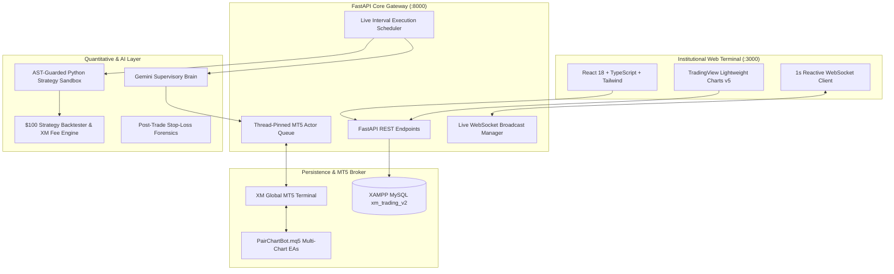

# XM Global MT5 Automated Trading & Strategy Testing Portal (V2)

An institutional-grade, multi-asset automated trading terminal and strategy testing portal engineered specifically for **XM Global MetaTrader 5** (`GOLD#`, `EURUSD#`, `GBPUSD#`, `USDJPY#`, `BTCUSD#`, `ETHUSD#`, `SOLUSD#`).

Built on deterministic Python backends, reactive React 18 frontends, TradingView Lightweight Charts v5, XAMPP MySQL persistence, and the Google Gemini AI SDK (`google-genai`).

---

## 🏛️ System Architecture



---

## 🛡️ Non-Negotiable Safety Invariants (`AGENTS.md`)

1. **Zero LLM Latency in Tick Execution**: Gemini AI NEVER manages tick-by-tick entries, stops, partial closes, or trailing stops. Per-chart MQL5 bots and deterministic Python handle execution locally.
2. **Zero Raw Code Injection by AI**: Gemini loops only output structured JSON filter rules. User-pasted strategy scripts run strictly through an AST-guarded Python Strategy Sandbox.
3. **Dual-Mode Per-Chart Isolation**: Every chart bot supports simultaneous Scalping (`magic_number = 1001`) and Swing (`magic_number = 2001`) trades without exit interference.
4. **Zero-Naked-Order Hard Lock**: No order can be placed without valid `sl`, `tp1`, and `tp2`. Orders sent without valid stops are immediately aborted by the gateway.
5. **Double-Confirmation Demo/Live Profile Switching**: Live trading profiles require explicit 2FA/token authorization (`CONFIRM_LIVE_TRADING`).
6. **Zero Synthetic / Random Candles**: All charts, backtests, and AI market packets use genuine OHLCV feeds from XM Global MT5.

---

## ⚡ Key Modules

- **AST-Guarded Strategy Sandbox** (`backend/app/strategy_lab/sandbox.py`):
  Blocks dangerous AST nodes (`open`, `eval`, `exec`, `__import__`, attribute inspection) while injecting vectorized indicator helpers (`atr`, `ema`, `rsi`, `swing_highs`, `swing_lows`, `detect_fvg`, `detect_liquidity_sweep`).
- **Realistic XM Global Fee Engine** (`backend/app/strategy_lab/xm_fee_model.py`):
  Computes exact Bid/Ask spreads, slippage, and overnight swaps (including 3x Wednesday triple swap) calibrated to XM Ultra Low / Standard contract specifications.
- **$100 Strategy Tester** (`backend/app/strategy_lab/backtester.py`):
  Zero look-ahead bar-by-bar backtest simulation featuring `$100 Trade Mode` (`PER_TRADE_100`) and `$100 Compounding Account Mode` (`ACCOUNT_100`) with micro-lot break-even and partial take-profit rules.
- **Gemini Supervisory Brain** (`backend/app/ai_brain/gemini_supervisor.py`):
  Multi-timeframe price action analysis (`M5`, `M15`, `H1`, `H4`, `D1`), Tier-1 macroeconomic calendar blackout protection (`news_guard.py`), and 4 execution modes: `AUTO`, `COPILOT (1-Click)`, `MONITOR`, and `HALTED`.
- **TradingView Terminal Cockpit** (`frontend/src/components/tabs/CockpitTab.tsx`):
  Real-time institutional candlesticks with dynamic S/R zones, Fair Value Gap boxes, PDH/PDL reference lines, Copilot staging cards, and 1-second WebSocket telemetry.

---

## 🚀 Quick Start Guide

### Prerequisites
- Windows 10/11
- Python 3.11+
- Node.js 18+ & npm
- XAMPP with MySQL running on `127.0.0.1:3306`
- XM Global MT5 Terminal (`terminal64.exe`)

### 1. Database Setup
Ensure MySQL is running in XAMPP:
```sql
CREATE DATABASE IF NOT EXISTS xm_trading_v2;
```

### 2. Backend Installation & Startup
```powershell
# In project root
python -m venv .venv
.\.venv\Scripts\Activate.ps1
pip install -r requirements.txt

# Start backend server daemon
uvicorn backend.app.api.server:app --host 127.0.0.1 --port 8000 --reload
```

### 3. Frontend Installation & Startup
```powershell
cd frontend
npm install
npm run dev
```
Open [http://localhost:3000](http://localhost:3000) in your browser.

### 4. 24/7 Production Runner
A one-click batch launcher is provided in the root directory:
```powershell
.\start_24x7.bat
```

---

## 🧪 Testing & Verification

Run the comprehensive unit and integration test suite:
```powershell
pytest -v
```

---

## 📄 License
Proprietary & Confidential. All rights reserved.
